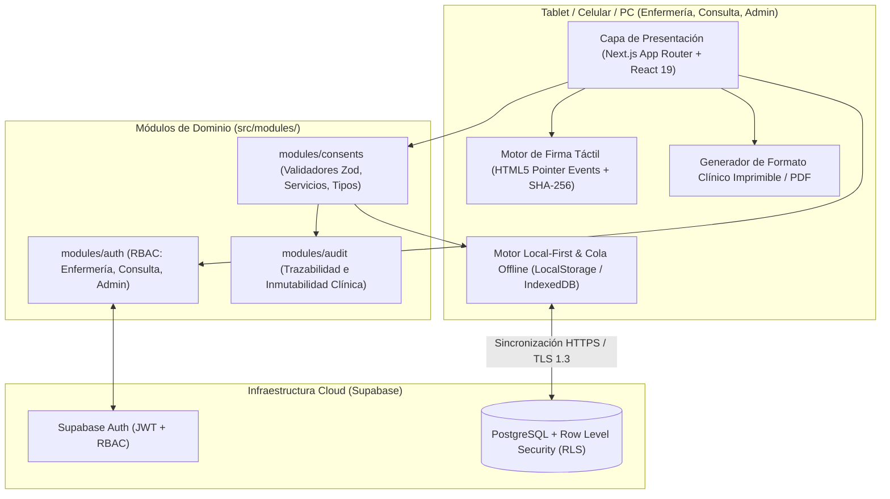

# Arquitectura del Sistema — Gestión de Consentimientos Clínicos

Este documento describe la arquitectura del sistema siguiendo el estándar de **Monolito Modular Escalable** de **GST-SOFTWARE**.

---

## 1. Diagrama de Arquitectura (C4 - Contenedores y Flujo Offline/Online)



---

## 2. Estructura Modular por Dominio

```text
src/
├── app/                              # Rutas Next.js App Router
│   ├── layout.tsx                    # Root Layout con estilos globales e impresión
│   └── page.tsx                      # Plataforma principal (Dashboard, Nuevo Formato, Historial, Admin)
├── components/
│   └── ui/                           # Componentes base reutilizables (SignaturePad, Badges, Modals)
├── lib/
│   ├── supabase/                     # Clientes Supabase (Browser & Server)
│   └── crypto/                       # Generación de hash SHA-256 de integridad documental
├── modules/
│   ├── auth/                         # Roles (enfermería, consulta, admin) y sesión activa
│   ├── consents/                     # Dominio principal de Consentimientos y Pertenencias
│   │   ├── components/               # Formulario clínico, Vista PDF/Impresión, Historial, Admin Textos
│   │   ├── schemas/                  # Validaciones Zod (Regla de menor/incapaz, acta de devolución)
│   │   ├── services/                 # Persistencia híbrida (Offline + Supabase) y trazabilidad
│   │   └── types/                    # Contratos TypeScript estrictos
│   └── audit/                        # Bitácora inmutable de eventos (creación, firma, anulación)
└── types/                            # Tipos globales
```

---

## 3. Garantías No Funcionales y Legales

1. **Inmutabilidad Post-Firma (Resolución 1995 de 1999):**
   - Todo formato nace en estado `SIGNED` al completarse las firmas obligatorias y genera un hash criptográfico `SHA-256` calculado sobre los datos del paciente, los textos legales aceptados/rechazados, el inventario de pertenencias y las firmas en Base64.
   - El servicio rechaza cualquier intento de `UPDATE` sobre los datos clínicos de un formato firmado. La única transición permitida es hacia `ANNULLED` con justificación obligatoria.
2. **Operación Offline y Sincronización:**
   - Si la tablet pierde conectividad Wi-Fi/datos en hospitalización, el formato se guarda localmente con estado de sincronización `PENDING_SYNC`. Cuando regresa la conexión (o al pulsar "Sincronizar"), se envía a Supabase y pasa a `SYNCED`.
